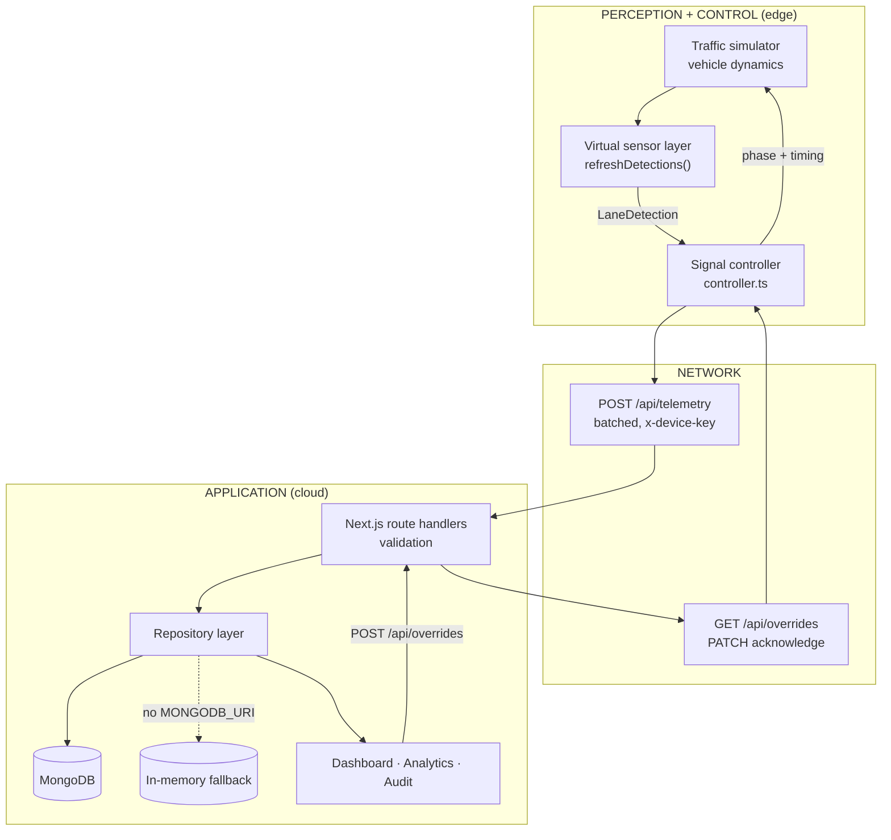
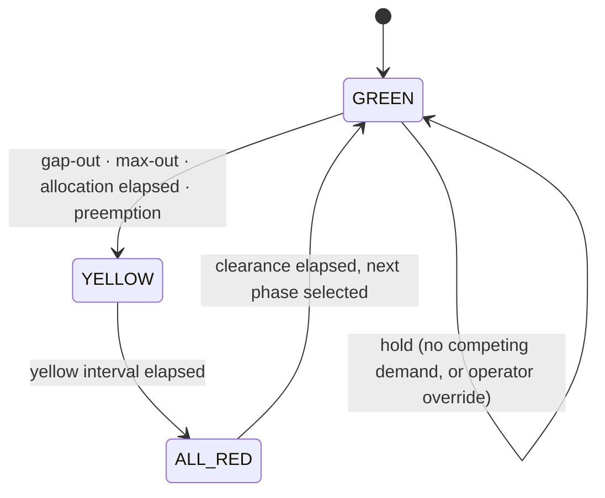
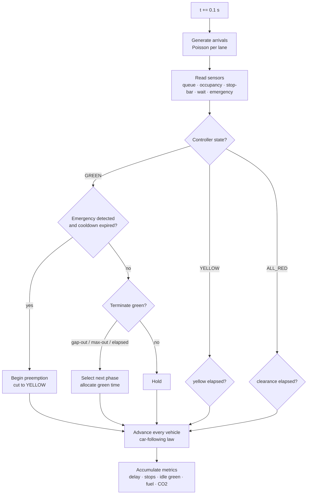
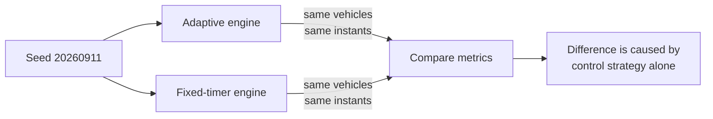
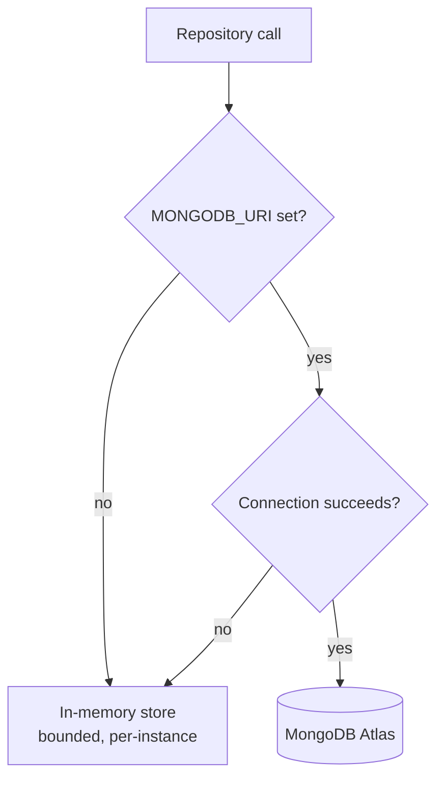

# Architecture

System design, data flow and the reasoning behind the significant decisions.

---

## 1. Three-tier model

The system follows the perception / network / application model described in the project report.

| Tier | Responsibility | Implementation | Status |
|---|---|---|---|
| Perception | Detect vehicles, queues and emergency vehicles per lane | Microscopic traffic simulator producing `LaneDetection` records | **Simulated** |
| Network | Carry telemetry upward and commands downward | HTTPS JSON, device-key auth, batched upload, command polling | **Real** |
| Application | Store, visualise, report, control | Next.js App Router, MongoDB via Mongoose, React dashboard | **Real** |

The boundary between tier one and tier two is a plain JSON contract. This is the single most
important design decision in the project: it is what allows a Raspberry Pi to be dropped in later
without touching the algorithm, the API, the database or the dashboard.

---

## 2. Component diagram



---

## 3. Control loop

The controller runs a four-phase, fully-actuated state machine on a fixed 0.1 s timestep.



Each tick, in order:



Order matters: sensors are read **before** the controller decides, and vehicles move **after**, so
the controller always acts on the state of the world as it was at the start of the tick.

---

## 4. The measurement design

Two engines are constructed with the same seed and stepped in lockstep.



This works because arrival generation consumes the random stream in a **strict fixed order**
— headway, then vehicle class, then the emergency roll — and both engines execute identical code on
identical timesteps. Any divergence in output is therefore attributable to control only.

The order dependency is fragile by nature, so it is called out explicitly in
`engine.ts :: generateArrivals()`. Adding a random draw to one branch and not the other would
silently break the experiment.

---

## 5. Request flow

### Telemetry (edge → cloud)

```
Controller
  │ every 5 s
  ├─ build payload: 8 lane readings + metrics + health
  ├─ POST /api/telemetry   header: x-device-key
  │
  ▼
Route handler
  ├─ checkDeviceKey()           401 if wrong
  ├─ extractBatch()             single doc, array, or { batch: [...] }
  ├─ normaliseTelemetry()       coerce types, clamp, reject malformed
  ├─ insertTrafficLogs()        repository → MongoDB or memory
  └─ markIntersectionSeen()     refresh heartbeat + status
```

### Commands (cloud → edge)

```
Operator (dashboard)
  │ POST /api/overrides  header: x-operator-passcode
  ▼
Route handler → validate action/phase → createOverride(status: pending)
                                      → createIncident(audit trail)
  ▼
                            [ command sits in the database ]
  ▼
Controller polls GET /api/overrides?intersectionId=…   every 4 s
  ├─ applies each command to the engine
  └─ PATCH /api/overrides { ids: [...] }  → status: acknowledged
```

Commands are queued rather than applied directly because in the field the cloud cannot reach the
controller synchronously. Modelling it this way means the latency visible on the dashboard is real
command latency, and the acknowledgement path — the part most likely to be skipped in a prototype —
actually exists.

---

## 6. Storage strategy



Every route handler talks to `repository.ts`, never to Mongoose directly. The fallback exists for a
specific reason: a live project defence cannot depend on conference-centre Wi-Fi reaching an Atlas
cluster. The application is fully demonstrable with zero infrastructure, and `/api/health` always
reports honestly which backend is in use.

The in-memory store is bounded (2000 telemetry documents, 500 incidents) so a long-running demo
cannot exhaust a serverless function's memory.

### Connection caching

Serverless functions keep module scope alive between invocations on a warm instance but can be
recycled at any time. Opening a connection per request would exhaust the Atlas pool immediately, so
the connection promise is cached on `globalThis` and reused — the standard pattern for Mongoose on
Vercel.

---

## 7. Why the browser needs its own routes

`/api/telemetry` and `/api/overrides` are authenticated with `DEVICE_API_KEY`, a **server-side
secret**. A browser must never hold it — anything shipped to the client is public.

During a demo the browser is standing in for the Raspberry Pi, so it uploads through two
same-origin routes instead:

| Device route (real hardware) | Browser route (simulator) |
|---|---|
| `POST /api/telemetry` | `POST /api/edge/telemetry` |
| `GET /api/overrides` | `GET /api/edge/commands` |
| `PATCH /api/overrides` | `PATCH /api/edge/commands` |

The `/api/edge/*` routes perform identical validation and write to the identical store; only the
credential differs. They enforce a same-origin check and **cannot create commands** — issuing a
command still requires the operator passcode on `/api/overrides`. A real controller never touches
them.

This is a deliberate trade-off, documented rather than hidden: the alternative (shipping the device
key to the browser) would be a genuine security flaw, and the alternative of having no in-browser
demo would make the project far harder to present.

---

## 8. Rendering

| Concern | Approach | Reason |
|---|---|---|
| Vehicle plan view | HTML5 Canvas, redrawn per snapshot | Dozens of moving objects per frame; DOM nodes would thrash |
| Charts | Hand-built inline SVG | Exact control over mark specs; validated colour palette; one less dependency |
| Simulation loop | `requestAnimationFrame` with an accumulator | Physics integrates at a fixed 0.1 s step regardless of frame rate |
| React updates | Snapshots published at ~20 fps, not every frame | The model runs at full rate; React does not need to |

The simulation state lives in a `useRef`, not in React state. Engines are created once, lazily, so
server rendering never touches them and a re-render never discards accumulated state.

### Chart colour

The two series colours (`#3987e5` adaptive, `#d95926` fixed) were validated rather than chosen by
eye — checked for lightness band, chroma floor, colour-vision-deficiency separation and contrast
against the `#0d121e` chart surface. Worst-case CVD separation is ΔE 26.8 (protan), well clear of
the ΔE 8 floor. Series identity is additionally carried by a legend and direct end-of-line labels,
so it never depends on colour alone, and every chart offers a table view.

---

## 9. Design decisions and trade-offs

**Four phases rather than the report's four lanes.** Serving each approach individually would be
simpler to explain but is not how real junctions work — opposing approaches have no conflicting
movements and are served together. The four-phase plan roughly doubles capacity for the same cycle
length.

**Critical queue, not total queue, sets green time.** The two lanes a phase serves discharge in
parallel, so the binding constraint is the longer of the two. Using the sum would systematically
over-allocate green.

**A safe-speed car-following law rather than scripted queues.** One rule — never exceed the speed
from which you could still stop within the available gap — reproduces queue build-up, the startup
wave at green, and saturation discharge without any of them being programmed. It also means the
measured saturation flow is an emergent property that can be sanity-checked against the literature.

**Preemption has a ceiling and a cooldown.** Discovered by measurement, not by design: see
[CHAPTER-MAPPING.md](CHAPTER-MAPPING.md) §5 and the note in the README.

**Idle green counts only conditional waste.** Green shown to an empty approach is only waste if
another approach has vehicles waiting. A controller resting in green on a deserted junction at 3am
wastes nothing. The unconditional definition would have flattered the fixed baseline and
misrepresented both systems.

**Explicit Mongoose document interfaces instead of `InferSchemaType`.** Type inference over four
schemas of this size exhausts the TypeScript compiler's heap. Writing the interfaces out costs a
few lines and makes the schema easier to read next to it.
